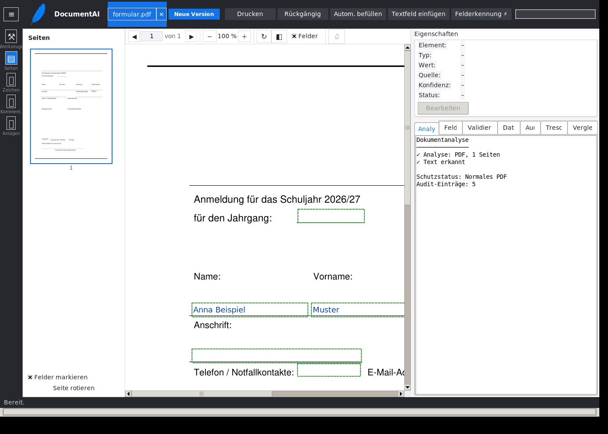
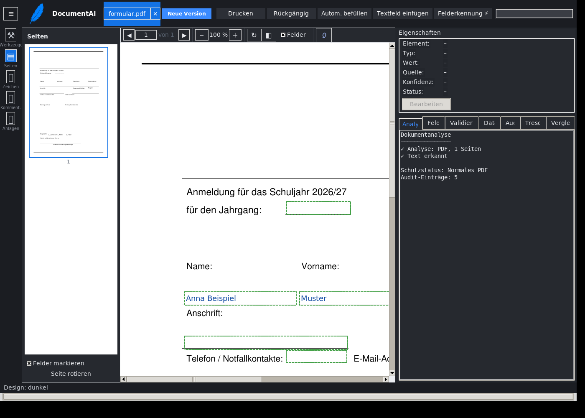
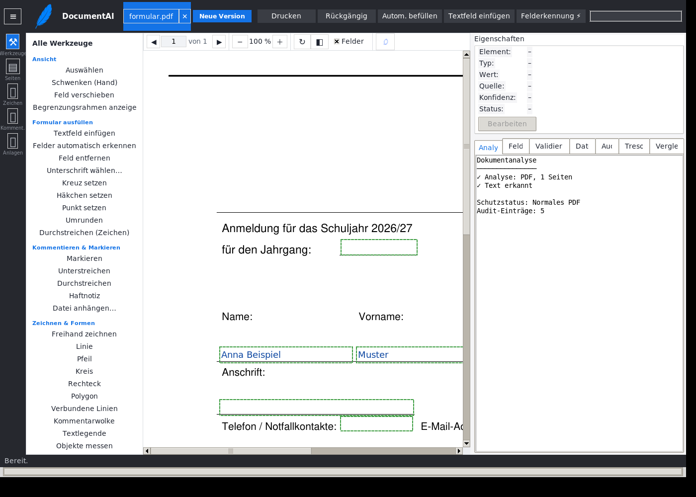

<div align="center">


# DocumentAI

**Lokale Dokumentenintelligenz – PDFs analysieren, Formulare erkennen, ausfüllen und bearbeiten. Komplett offline.**

Sprachen / Languages / Языки / Langues / 语言：
**Deutsch** | [English](README.en.md) | [Русский](README.ru.md) | [Français](README.fr.md) | [中文](README.zh-CN.md)


</div>

---

## Was ist DocumentAI?

DocumentAI ist eine Desktop-Anwendung für PDF-Dokumente: Sie **analysiert**
Dokumente, **erkennt Formularfelder** automatisch, **füllt Formulare aus**,
stellt **über 40 Werkzeuge** zum Kommentieren und Bearbeiten bereit,
**vergleicht** Versionen, **exportiert** in Office-Formate und verwaltet
Profildaten in einem **lokal verschlüsselten Tresor** – alles ohne Cloud,
ohne Konto, ohne Telemetrie.

Die Werkzeugpalette orientiert sich am Funktionsumfang von
**Adobe Acrobat Reader DC (Professional)** – vollständig lokal und
offline nachgebaut, ohne Abo und ohne Lizenzschlüssel.

## Funktionen

### Formularfeld-Erkennung
- **Zeilen-Paar-Modell**: Beschriftung oben, Eingabelinie darunter – der
  einzugebende Text landet **genau auf der Linie** wie handschriftlich
- Raster und Tabellen: leere Zellen werden Felder, Spalten-Header
  (z. B. Wochentage) werden zu Checkboxen mit sprechenden Beschriftungen
- Typ-Erkennung: Datum, Telefon, E-Mail, PLZ, IBAN, Unterschrift, Zahl, Text
- Checkboxen anhand gezeichneter Kästchen und Glyphe
- Erkannte Felder bei Bedarf **mit der Maus verschieben**

### Werkzeuge (45)
Auswählen, Schwenken, Textfeld einfügen, Kreuz/Häkchen/Punkt setzen,
Umrunden, Markieren, Unterstreichen, Durchstreichen, Haftnotiz,
Datei anhängen, Freihand zeichnen, Linie, Pfeil, Kreis, Rechteck,
Polygon, Verbundene Linien, Kommentarwolke, Textlegende, Objekte messen,
Text einfügen, Bild einfügen, Verknüpfung, Wasserzeichen, Kopf-/Fußzeile,
Bates-Nummerierung, Hintergrundfarbe, Schwärzen, Geschützt speichern,
Signieren, Zertifizierte Kopie, Seiten verwalten (löschen, drehen,
verschieben, zusammenführen), Konvertieren (Word, Excel, PowerPoint,
Text, RTF), Drucken, Stempel, Felderkennung, Feld entfernen,
Feld verschieben, Begrenzungsrahmen – jedes Werkzeug mit **eigenem Symbol**
und Erklärung in der Statusleiste.

### OCR
Scans werden mit **Tesseract** (deu+eng) gelesen. Vorverarbeitung
(Graustufen, 2×-Hochskalierung, Auto-Kontrast) verbessert die Erkennung
kleiner Beschriftungen; die Scan-Struktur-Analyse findet Feldlinien und
Kästchen auch ohne Textebene.

### Daten & Datenschutz
- **Automatisch befüllen** aus Profildaten (Familienmitglieder) mit
  Konfidenz-Anzeige und Validierung
- **Datentresor**: lokal verschlüsselt (AES-256-GCM), Master-Passwort
  optional im Windows-Keyring
- **Versionierung**: „Neue Version speichern“, Rückgängig/Wiederholen,
  Versionsvergleich (Textdiff, Felddiff, visueller Vergleich als Bild)
- **Export**: Word (.docx), Excel (.xlsx), PowerPoint (.pptx), Text, RTF
- **Ganz lokal**: keine Cloud, keine Netzverbindung nötig, keine
  Dokumentinhalte verlassen den Rechner

### Oberfläche
- Acrobat-artiges Layout: Werkzeugschiene, Miniaturansichten,
  Navigation, Eigenschaften-Panel
- **Helles und dunkles Design** (Umschalter, Auswahl wird gespeichert)
- Mausrad-Scrollen, Zoom, Inline-Bearbeitung (Klick ins Feld, Esc beendet)


*Felderkennung: Der eingegebene Text sitzt auf der Eingabelinie.*


*Dunkles Design.*


*Werkzeugkasten mit Symbolen.*

## Installation (Windows)

1. ZIP-Archiv `DocumentAI-Installer_…_v18_1.9.1.zip` von der
   [Release-Seite](../../releases) herunterladen
2. Entpacken (Rechtsklick → „Alle extrahieren“)
3. `DocumentAI-installieren.bat` doppelklicken

Das war alles. Die Installation bringt eine eigene Python-Runtime und alle
Bibliotheken mit – **keine Administratorrechte, keine Internetverbindung**.
Alte Installationen und Verknüpfungen werden automatisch aufgeräumt
(Nutzerdaten bleiben erhalten).

## Installation aus dem Quellcode

Voraussetzungen: Python 3.10+ (getestet: 3.12) und Tesseract optional für OCR.

```bash
pip install -r requirements.txt
python DocumentAI.py            # grafische Oberfläche
python DocumentAI.py --cli …    # Kommandozeilenmodus
python DocumentAI.py --selbsttest
```

Für OCR zusätzlich das Tesseract-Binary installieren (Windows:
UB-Mannheim-Build; Debian/Ubuntu: `tesseract-ocr tesseract-ocr-deu`).
Ohne Tesseract läuft alles übrige normal – OCR degradiert sauber mit Hinweis.

## Architektur

| Modul | Aufgabe |
|---|---|
| `documentai/engines/field_detector.py` | Visuelle Formularfeld-Erkennung (Zeilen-Paare, Raster, Bänder, Lücken, Kästchen) |
| `documentai/engines/semantic.py` | Typ- und Kanoniker-Erkennung (deutsche Komposita) |
| `documentai/engines/ocr.py` | Tesseract-Anbindung mit Vorverarbeitung |
| `documentai/engines/annotate.py` | Anmerkungen (Markieren, Zeichnen, Stempel, Schwärzen …) |
| `documentai/engines/exporter.py` | Export/Import (docx, xlsx, pptx, txt, rtf) |
| `documentai/engines/compare.py` | Text-, Feld- und visueller Vergleich |
| `documentai/engines/signatures.py` | Signatur-Analyse, Signieren (pyhanko) |
| `documentai/services/` | Analyse-Service, Profile, Tresor, Werkzeug-Suche |
| `documentai/gui/` | tkinter-Oberfläche, Themen (hell/dunkel), Panels |
| `documentai/bilder/symbole.py` | Lokal gezeichnete Werkzeug-Symbole |
| `tests/` | 249 Tests (Felderkennung, GUI, Pipeline, Export, Tresor …) |

## Tests

```bash
python -m pytest tests/ -q
```

- **249 Host-Tests** (Unit + GUI unter Xvfb)
- **Windows-Labor**: komplette Suite unter Wine
- **Frischinstallations-Verifikation**: Installer → Installation →
  Smoke-Test → GUI-Test, vollautomatisiert

## Installer selbst bauen

Der Windows-Installer wird unter Linux mit Wine gebaut:

```bash
bash winenv/rebuild-windows-lab.sh   # Wine-Labor aufbauen
bash winenv/build-installer-v5.sh    # Installer-ZIP bauen
bash winenv/verify-windows.sh        # Installation verifizieren
```

## Dokumentation

- [CHANGELOG](CHANGELOG.md) – alle Versionen
- [Testbericht](docs/TESTBERICHT.md) – vollständige Verifikationshistorie (deutsch)
- [Installer-Anleitung](docs/LIESMICH.txt) – beiliegende Installationsanleitung (deutsch)

## Sicherheit & Datenschutz

Siehe [SECURITY.md](SECURITY.md). Kurz: Alle Verarbeitung erfolgt lokal;
der Datentresor ist AES-256-GCM-verschlüsselt; „Geschützt speichern“
erzeugt passwortgeschützte PDFs (AES-256); Schwärzen entfernt Inhalte
endgültig.

## Mitwirken

Siehe [CONTRIBUTING.md](CONTRIBUTING.md).

## Lizenz

[MIT](LICENSE) – Copyright © 2026 DocumentAI.

---

<div align="center">

**DocumentAI – Ihre Dokumente bleiben Ihre Dokumente.**

</div>
